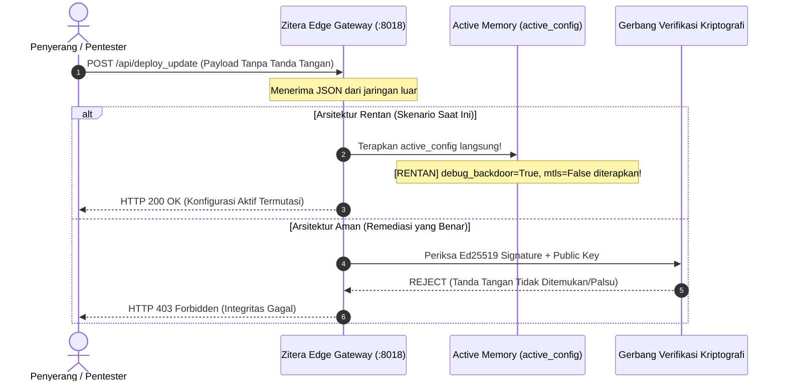

# Arsitektur Sistem & Titik Kelemahan Integritas (A08)

Modul **A08: Software or Data Integrity Failures** mensimulasikan gerbang ingesti pembaruan firmware dan konfigurasi pada perangkat **Zitera Edge Gateway (Port 8018)**. Layanan ini merefleksikan arsitektur sistem tertanam (*embedded system*) atau mikroservis IoT yang menerima arahan konfigurasi dinamis melalui REST API.

---

## 1. Topologi Layanan & Pemetaan Endpoint

Perangkat Zitera Edge mengekspos endpoint HTTP berikut pada port 8018:

| Metode | Endpoint | Hak Akses | Deskripsi Fungsionalitas | Karakteristik Keamanan |
| :--- | :--- | :--- | :--- | :--- |
| `GET` | `/` | Publik | Konsol Web Status Konfigurasi Aktif. | Menampilkan parameter runtime saat ini (`active_config`). |
| `GET` | `/health` | Publik | Healthcheck status layanan lab. | Mengembalikan JSON status ketersediaan port 8018. |
| `GET` | `/api/config` | Publik | API pembacaan konfigurasi aktif. | Mengembalikan objek konfigurasi yang sedang dieksekusi memori. |
| `POST` | `/api/deploy_update` | Publik | Endpoint pembaruan konfigurasi/firmware. | **VULNERABLE**: Menerima payload tanpa validasi kriptografis. |
| `POST` | `/api/reset` | Publik | Reset konfigurasi ke setelan default pabrik. | Mengembalikan state `DEFAULT_CONFIG` bertanda tangan valid. |
| `GET` | `/practice/verify` | Internal/Tester | Verifikasi otomatis penyelesaian target lab. | Menguji apakah konfigurasi tak tepercaya berhasil disuntikkan. |

---

## 2. Diagram Aliran Data & Peruntuhan Batas Kepercayaan

Diagram berikut mengilustrasikan bagaimana payload yang tidak diverifikasi menembus batas kepercayaan sistem runtime:



---

## 3. Analisis Anatomi Kode Rentan (`app.py`)

Kelemahan fatal terletak pada fungsi pengendali request `do_POST` di dalam `docker/app.py`:

```python
if parsed.path == "/api/deploy_update":
    # VULNERABILITY: Blindly trusts client-supplied package without validating cryptographic signature
    active_config = {
        "version": payload.get("version", "2.0.0-custom"),
        "signature_verified": payload.get("signature_verified", False),
        "signer": payload.get("signer", "unverified-external-source"),
        "params": payload.get("params", {"debug_backdoor": True})
    }
    tampered_accepted = True
    resp = {
        "status": "applied",
        "message": "Configuration package deployed directly into memory.",
        "active_config": active_config
    }
    if active_config.get("params", {}).get("debug_backdoor") is True or not active_config["signature_verified"]:
        resp["flag"] = FLAG
    self._send_json(200, resp)
```

### Kesalahan Arsitektur Fatal:
1. **Delegasi Validasi ke Klien**: Server membaca `payload.get("signature_verified")`. Mengizinkan klien mengklaim apakah data sudah diverifikasi atau belum adalah anti-pattern fatal.
2. **Ketiadaan Validasi Kunci Publik**: Tidak ada mekanisme pengecekan sertifikat x509, signature Ed25519, atau HMAC terhadap secret server.
3. **Penyuntikan Langsung ke Runtime State**: Data klien langsung menimpa variabel global `active_config` tanpa melewati lapisan sanitasi skema (*strict schema validation*).
