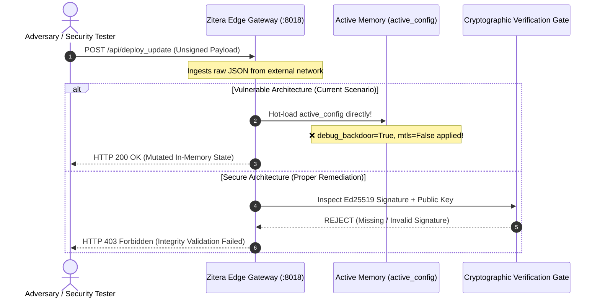

# System Architecture & Integrity Vulnerability Analysis (A08)

The **A08: Software or Data Integrity Failures** module models a dynamic firmware and configuration ingestion service deployed on the **Zitera Edge Gateway (Port 8018)**. This architecture represents IoT gateways, microservice nodes, and automotive telematics systems accepting remote operational parameters via REST APIs.

---

## 1. Service Topology & Endpoint Inventory

The Zitera Edge service exposes the following HTTP endpoints on port 8018:

| Method | Endpoint | Authorization | Functional Role | Security Posture |
| :--- | :--- | :--- | :--- | :--- |
| `GET` | `/` | Public | Active Configuration Web Dashboard. | Renders current active memory parameters (`active_config`). |
| `GET` | `/health` | Public | Service health probe. | Returns JSON liveness status for port 8018. |
| `GET` | `/api/config` | Public | Active configuration reader. | Returns in-memory operational dictionary. |
| `POST` | `/api/deploy_update` | Public | Configuration & firmware deployment endpoint. | **VULNERABLE**: Blindly hot-loads untrusted JSON payloads. |
| `POST` | `/api/reset` | Public | Factory reset endpoint. | Restores default signed configuration state. |
| `GET` | `/practice/verify` | Internal/Tester | Automated mission verification gate. | Assesses if unsigned/tampered package was hot-loaded. |

---

## 2. Data Flow & Trust Boundary Collapse

The following diagram illustrates how untrusted configuration payloads breach system runtime memory boundaries:



---

## 3. Vulnerable Code Anatomy (`docker/app.py`)

The critical flaw resides in the `do_POST` dispatch handler inside `docker/app.py`:

```python
if parsed.path == "/api/deploy_update":
    # VULNERABILITY: Blindly trusts client-supplied package without validating cryptographic signature
    active_config = {
        "version": payload.get("version", "2.0.0-custom"),
        "signature_verified": payload.get("signature_verified", False),
        "signer": payload.get("signer", "unverified-external-source"),
        "params": payload.get("params", {"debug_backdoor": True})
    }
    tampered_accepted = True
    resp = {
        "status": "applied",
        "message": "Configuration package deployed directly into memory.",
        "active_config": active_config
    }
    if active_config.get("params", {}).get("debug_backdoor") is True or not active_config["signature_verified"]:
        resp["flag"] = FLAG
    self._send_json(200, resp)
```

### Key Architectural Vulnerabilities:
1. **Client-Controlled Integrity Assertion**: The server trusts the client's own statement (`payload.get("signature_verified")`). Delegating integrity verification to callers completely defeats the boundary.
2. **Missing Asymmetric Verification**: No cryptographic verification (e.g., Ed25519, RSA-PSS, or Sigstore cosign) takes place against an authoritative public key ring.
3. **Unrestricted In-Memory Mutation**: Client-provided JSON parameters directly overwrite the core operational parameters of the running process without schema or constraint enforcement.
