# Arsitektur Sistem & Titik Buta Telemetri (A09)

Modul **A09: Security Logging & Alerting Failures** mensimulasikan lingkungan operasional konsol Security Operations Center (SOC) dan gateway autentikasi pada **Zitera SOC Audit & Telemetry Console (Port 8019)**. Layanan ini mencerminkan kegagalan telemetri dalam infrastruktur mikroservis perusahaan di mana aktivitas invasif terjadi tanpa memicu alarm atau meninggalkan jejak audit.

---

## 1. Topologi Layanan & Pemetaan Endpoint

Perangkat Zitera SOC Console mengekspos endpoint HTTP berikut pada port 8019:

| Metode | Endpoint | Hak Akses | Deskripsi Fungsionalitas | Karakteristik Telemetri |
| :--- | :--- | :--- | :--- | :--- |
| `GET` | `/` | Publik | Dashboard Web Status Telemetri & Log SOC. | Menampilkan status alarm dan tabel stream log audit. |
| `GET` | `/health` | Publik | Healthcheck status layanan lab. | Mengembalikan JSON status ketersediaan port 8019. |
| `GET` | `/api/audit/logs` | Publik | REST API pembacaan stream log audit. | Mengembalikan array `logs` dan jumlah `alerts_fired`. |
| `POST` | `/api/auth/login` | Publik | Endpoint verifikasi login kredensial. | **VULNERABLE**: Kegagalan login tidak dicatat ke log audit dan menghasilkan 0 alert. |
| `POST` | `/api/admin/role_escalate` | Publik | Endpoint perubahan/eskalasi peran akun. | **VULNERABLE**: Perubahan peran dieksekusi diam-diam tanpa catatan audit trail. |
| `POST` | `/api/reset` | Publik | Reset telemetri log dan status insiden. | Mengosongkan memori log audit dan mereset penghitung. |
| `GET` | `/practice/verify` | Internal/Tester | Verifikasi otomatis pemenuhan target lab. | Memvalidasi reproduksi serangan senyap ($\ge 5$ gagal login & 1 silent escalation). |

---

## 2. Diagram Aliran Data & Titik Buta Deteksi

Diagram urutan berikut membandingkan bagaimana aliran data diproses pada arsitektur rentan saat ini versus arsitektur aman yang dilengkapi telemetri terstruktur:

```mermaid
sequenceDiagram
    autonumber
    actor Attacker as Penyerang / Pentester
    participant SOCApp as Zitera SOC Gateway (:8019)
    participant AuditTrail as In-Memory Audit Trail (audit_logs)
    participant SIEMEngine as SIEM / Alerting Rule Engine

    rect rgb(40, 20, 20)
        Note over Attacker,SIEMEngine: Skenario Rentan (Telemetri Cacat)
        Attacker->>SOCApp: POST /api/auth/login (Password Salah x5)
        Note over SOCApp: failed_login_count += 1
        Note over SOCApp: [RENTAN] Tidak ada penulisan ke audit_logs!
        Note over SOCApp: [RENTAN] 0 Alerts Fired ke SIEM!
        SOCApp-->>Attacker: HTTP 401 Unauthorized

        Attacker->>SOCApp: POST /api/admin/role_escalate (learner -> super_admin)
        Note over SOCApp: unlogged_escalation_occurred = True
        Note over SOCApp: [RENTAN] Tidak dicatat di audit_logs!
        SOCApp-->>Attacker: HTTP 200 OK (Hak Akses Diberikan Secara Senyap)
    end

    rect rgb(20, 40, 20)
        Note over Attacker,SIEMEngine: Skenario Aman (Pertahanan Sempurna)
        Attacker->>SOCApp: POST /api/auth/login (Password Salah)
        SOCApp->>AuditTrail: Catat Event: auth.login.failed (IP, Timestamp)
        SOCApp->>SIEMEngine: Evaluasi Aturan: Gagal >= 5 dalam 5 menit?
        SIEMEngine-->>SOCApp: TRIGGER CRITICAL ALERT (IP Banned, SOC Notified)
    end
```



---

## 3. Analisis Anatomi Kode Rentan (`docker/app.py`)

Kelemahan telemetri terletak pada penanganan request POST di `app.py`:

### A. Titik Buta 1: Ketiadaan Pencatatan Kegagalan Autentikasi
```python
if parsed.path == "/api/auth/login":
    user = payload.get("username", "guest")
    pwd = payload.get("password", "")
    if user == "admin" and pwd == "correct_horse_battery":
        self._send_json(200, {"status": "authenticated", "role": "admin"})
    else:
        # VULNERABILITY: Fails to record failed attempt in security audit trail and raises zero alerts
        failed_login_count += 1
        self._send_json(401, {"error": "Invalid credentials", "attempt": failed_login_count})
```
Meskipun variabel `failed_login_count` bertambah di memori privat server, objek ini **tidak pernah dimasukkan ke dalam `audit_logs`**, dan tidak ada sinyal alert yang dinaikkan. Dari kacamata analis SOC yang memantau stream `/api/audit/logs`, aktivitas server terlihat tenang tanpa insiden.

### B. Titik Buta 2: Eskalasi Hak Istimewa Tanpa Jejak (*Silent Role Escalation*)
```python
elif parsed.path == "/api/admin/role_escalate":
    # VULNERABILITY: Silent escalation without writing to audit_logs!
    target_user = payload.get("user", "learner")
    new_role = payload.get("role", "super_admin")
    unlogged_escalation_occurred = True
    resp = {
        "status": "granted",
        "message": f"User {target_user} escalated to {new_role} silently without audit trail entry.",
        "audit_recorded": False
    }
    if failed_login_count >= 5:
        resp["flag"] = FLAG
    self._send_json(200, resp)
```
Mengubah peran pengguna menjadi `super_admin` adalah salah satu aksi paling sensitif dalam tata kelola IAM (*Identity & Access Management*). Mengizinkan mutasi peran ini tanpa mencatat identitas aktor pemohon, IP asal, stempel waktu, dan peran target merupakan pelanggaran fatal terhadap prinsip kepatuhan dan akuntabilitas non-repudiasi.
