# System Architecture & Telemetry Blind Spot Analysis (A09)

The **A09: Security Logging & Alerting Failures** module models an enterprise Security Operations Center (SOC) telemetry and administrative authentication gateway hosted on the **Zitera SOC Audit & Telemetry Console (Port 8019)**. This environment illustrates common telemetry failures in microservice architectures where invasive adversary reconnaissance and privilege modification transpire completely undetected.

---

## 1. Service Topology & Endpoint Inventory

The Zitera SOC Console exposes the following HTTP endpoints on port 8019:

| Method | Endpoint | Authorization | Functional Role | Telemetry Characteristics |
| :--- | :--- | :--- | :--- | :--- |
| `GET` | `/` | Public | SOC Telemetry & Audit Stream Dashboard. | Renders live alert status and in-memory audit log table. |
| `GET` | `/health` | Public | Service health probe. | Returns JSON liveness status for port 8019. |
| `GET` | `/api/audit/logs` | Public | REST API reading audit stream. | Returns `logs` array and `alerts_fired` counter. |
| `POST` | `/api/auth/login` | Public | Credential verification endpoint. | **VULNERABLE**: Failed logins produce zero audit logs and zero alerts. |
| `POST` | `/api/admin/role_escalate` | Public | Administrative role assignment endpoint. | **VULNERABLE**: Executes privilege escalation silently with no audit entry. |
| `POST` | `/api/reset` | Public | Telemetry state and incident reset. | Flushes audit log memory and resets counters. |
| `GET` | `/practice/verify` | Internal/Tester | Automated mission verification gate. | Validates stealth attack execution ($\ge 5$ failed logins & 1 silent escalation). |

---

## 2. Data Flow & Detection Blind Spot Analysis

The sequence diagram below contrasts the current vulnerable architecture against a robust, telemetry-enabled defensive pipeline:

```mermaid
sequenceDiagram
    autonumber
    actor Attacker as Adversary / Security Tester
    participant SOCApp as Zitera SOC Gateway (:8019)
    participant AuditTrail as In-Memory Audit Trail (audit_logs)
    participant SIEMEngine as SIEM / Alerting Rule Engine

    rect rgb(40, 20, 20)
        Note over Attacker,SIEMEngine: Vulnerable Architecture (Telemetry Blind Spot)
        Attacker->>SOCApp: POST /api/auth/login (Invalid Password x5)
        Note over SOCApp: failed_login_count += 1
        Note over SOCApp: ❌ Zero write to audit_logs!
        Note over SOCApp: ❌ 0 Alerts Fired to SIEM!
        SOCApp-->>Attacker: HTTP 401 Unauthorized

        Attacker->>SOCApp: POST /api/admin/role_escalate (learner -> super_admin)
        Note over SOCApp: unlogged_escalation_occurred = True
        Note over SOCApp: ❌ Zero entry appended to audit_logs!
        SOCApp-->>Attacker: HTTP 200 OK (Privilege Granted Silently)
    end

    rect rgb(20, 40, 20)
        Note over Attacker,SIEMEngine: Hardened Architecture (Resilient Defense)
        Attacker->>SOCApp: POST /api/auth/login (Invalid Password)
        SOCApp->>AuditTrail: Append Event: auth.login.failed (IP, Timestamp)
        SOCApp->>SIEMEngine: Evaluate Rule: Failures >= 5 within 5 minutes?
        SIEMEngine-->>SOCApp: TRIGGER CRITICAL ALERT (IP Throttled, SOC Notified)
    end
```



---

## 3. Vulnerable Code Anatomy (`docker/app.py`)

The telemetry omissions reside within the POST dispatch logic of `docker/app.py`:

### A. Blind Spot 1: Unlogged Authentication Failures
```python
if parsed.path == "/api/auth/login":
    user = payload.get("username", "guest")
    pwd = payload.get("password", "")
    if user == "admin" and pwd == "correct_horse_battery":
        self._send_json(200, {"status": "authenticated", "role": "admin"})
    else:
        # VULNERABILITY: Fails to record failed attempt in security audit trail and raises zero alerts
        failed_login_count += 1
        self._send_json(401, {"error": "Invalid credentials", "attempt": failed_login_count})
```
While `failed_login_count` increments in private server memory, the event is **never appended to `audit_logs`**, and no alert condition is evaluated. An analyst monitoring `/api/audit/logs` observes an idle, unperturbed system while active brute-force password guessing is actively underway.

### B. Blind Spot 2: Silent Privilege Escalation
```python
elif parsed.path == "/api/admin/role_escalate":
    # VULNERABILITY: Silent escalation without writing to audit_logs!
    target_user = payload.get("user", "learner")
    new_role = payload.get("role", "super_admin")
    unlogged_escalation_occurred = True
    resp = {
        "status": "granted",
        "message": f"User {target_user} escalated to {new_role} silently without audit trail entry.",
        "audit_recorded": False
    }
    if failed_login_count >= 5:
        resp["flag"] = FLAG
    self._send_json(200, resp)
```
Elevating user authority to `super_admin` is among the most sensitive operations in any Identity & Access Management (IAM) lifecycle. Permitting role mutations without logging actor credentials, source IP, timestamp, and target role violates foundational non-repudiation and forensic accounting requirements.
