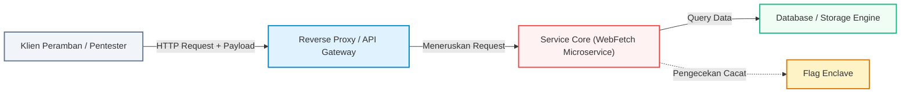

# Arsitektur Sistem & Model Alur Data: WebFetch Microservice

Praktikum ini menyimulasikan arsitektur microservice enterprise modern yang berjalan di `http://127.0.0.1:8060`.

### Titik Kelemahan Arsitektur:
1. **Batas Kepercayaan Terbuka (*Missing Trust Boundary*)**: Tidak ada pemisahan tegas antara parameter input yang dikontrol klien dengan data otentikasi internal.
2. **Ketiadaan Validasi Status**: Service Core mengeksekusi logika bisnis sebelum memastikan wewenang pengguna telah terverifikasi secara sah.
