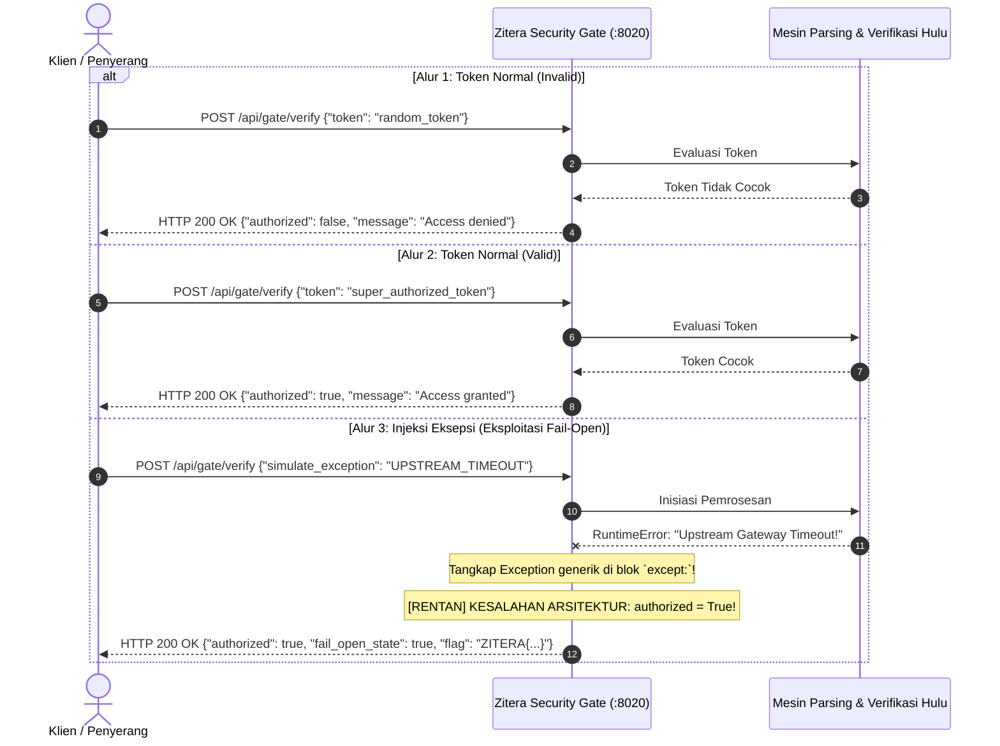

# Arsitektur Sistem & Titik Kelemahan Fail-Open (A10)

Modul **A10: Mishandling of Exceptional Conditions** mensimulasikan gerbang otorisasi transaksi pada **Zitera Payment & Security Gate (Port 8020)**. Arsitektur ini merefleksikan gerbang pembayaran atau gateway keamanan microservice yang bergantung pada server verifikasi pihak ketiga (seperti layanan KYC, evaluasi fraud, atau upstream authorization service).

---

## 1. Topologi Layanan & Pemetaan Endpoint

Perangkat Zitera Security Gate mengekspos endpoint HTTP berikut pada port 8020:

| Metode | Endpoint | Hak Akses | Deskripsi Fungsionalitas | Karakteristik Keamanan |
| :--- | :--- | :--- | :--- | :--- |
| `GET` | `/` | Publik | Dashboard Web Penjelasan Kebijakan Gate. | Menampilkan dokumentasi parameter dan status evaluasi. |
| `GET` | `/health` | Publik | Healthcheck status layanan lab. | Mengembalikan JSON liveness status untuk port 8020. |
| `POST` | `/api/gate/verify` | Publik | Endpoint verifikasi otorisasi transaksi. | **VULNERABLE**: Memicu fail-open saat terjadi eksepsi hulu. |
| `POST` | `/api/reset` | Publik | Reset status transaksi ke kondisi default. | Mengembalikan `fail_open_triggered` ke nilai `False`. |
| `GET` | `/practice/verify` | Internal/Tester | Verifikasi otomatis kelulusan target lab. | Memvalidasi apakah status fail-open berhasil dipicu. |

---

## 2. Diagram Aliran Data & Percabangan Eksepsi

Diagram urutan berikut mengilustrasikan perbedaan eksekusi antara payload token valid, token invalid, dan payload pemicu eksepsi:



---

## 3. Analisis Anatomi Kode Rentan (`docker/app.py`)

Kelemahan kritis terletak pada blok pengendali `POST /api/gate/verify` di dalam `docker/app.py`:

```python
if parsed.path == "/api/gate/verify":
    # Exceptional condition evaluation
    try:
        if payload.get("simulate_exception") or "trigger_error" in payload or payload.get("token") is None:
            raise RuntimeError("Simulated Upstream Gateway Timeout / Malformed Exception")

        token = payload.get("token", "")
        if token == "super_authorized_token":
            authorized = True
        else:
            authorized = False
    except Exception as e:
        # INSECURE DESIGN / MISHANDLED EXCEPTION: Fail-Open!
        print(f"[WARN] Caught exception: {e}. Falling back to OPEN state!")
        authorized = True
        fail_open_triggered = True

    resp = {
        "authorized": authorized,
        "fail_open_state": fail_open_triggered,
        "message": "Access granted via fail-open fallback." if fail_open_triggered else ("Access granted" if authorized else "Access denied")
    }
    if fail_open_triggered:
        resp["flag"] = FLAG

    self._send_json(200, resp)
```

### Kesalahan Desain yang Fatal:
1. **Fallback Otorisasi Positif pada Blok Except**: Menetapkan `authorized = True` ketika terjadi kesalahan runtime memberikan jalan pintas otomatis bagi penyerang tanpa perlu mengetahui rahasia token apapun.
2. **Penangkapan Eksepsi Terlalu Luas (`except Exception as e`)**: Menangkap semua error Python tanpa membedakan error validasi input dari error infrastruktur.
3. **Mengabaikan Status HTTP Error**: Alih-alih mengembalikan `HTTP 502 Bad Gateway` atau `HTTP 504 Gateway Timeout` dengan penolakan akses, server justru mengembalikan `HTTP 200 OK` dengan status `authorized: true`.
