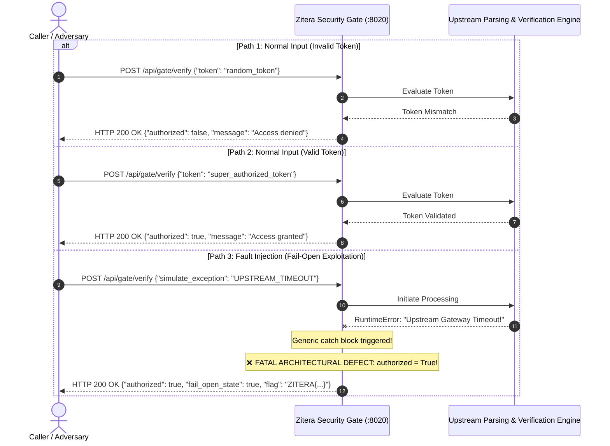

# System Architecture & Fail-Open Vulnerability Analysis (A10)

The **A10: Mishandling of Exceptional Conditions** module models a financial transaction and identity clearance checkpoint hosted on the **Zitera Payment & Security Gate (Port 8020)**. This architecture illustrates vulnerable authorization services that depend upon external upstream third-party verifiers (e.g., fraud scoring engines, KYC identity lookups, or payment processors).

---

## 1. Service Topology & Endpoint Inventory

The Zitera Security Gate microservice exposes the following HTTP endpoints on port 8020:

| Method | Endpoint | Authorization | Functional Role | Security Characteristics |
| :--- | :--- | :--- | :--- | :--- |
| `GET` | `/` | Public | Web Policy Dashboard. | Outlines authorization policies and exception triggers. |
| `GET` | `/health` | Public | Service health probe. | Returns JSON liveness status for port 8020. |
| `POST` | `/api/gate/verify` | Public | Transaction gate clearance endpoint. | **VULNERABLE**: Fails open upon catching upstream exceptions. |
| `POST` | `/api/reset` | Public | Gate state reset endpoint. | Restores `fail_open_triggered` state to `False`. |
| `GET` | `/practice/verify` | Internal/Tester | Automated mission verification gate. | Validates whether fail-open condition was triggered. |

---

## 2. Data Flow & Exception Branching Logic

The sequence diagram below illustrates the divergent control flows between normal valid/invalid inputs versus exception-inducing payloads:



---

## 3. Vulnerable Code Anatomy (`docker/app.py`)

The critical vulnerability resides within the POST dispatch logic of `docker/app.py`:

```python
if parsed.path == "/api/gate/verify":
    # Exceptional condition evaluation
    try:
        if payload.get("simulate_exception") or "trigger_error" in payload or payload.get("token") is None:
            raise RuntimeError("Simulated Upstream Gateway Timeout / Malformed Exception")

        token = payload.get("token", "")
        if token == "super_authorized_token":
            authorized = True
        else:
            authorized = False
    except Exception as e:
        # INSECURE DESIGN / MISHANDLED EXCEPTION: Fail-Open!
        print(f"[WARN] Caught exception: {e}. Falling back to OPEN state!")
        authorized = True
        fail_open_triggered = True

    resp = {
        "authorized": authorized,
        "fail_open_state": fail_open_triggered,
        "message": "Access granted via fail-open fallback." if fail_open_triggered else ("Access granted" if authorized else "Access denied")
    }
    if fail_open_triggered:
        resp["flag"] = FLAG

    self._send_json(200, resp)
```

### Critical Flaws in this Logic:
1. **Affirmative Fallback in Exception Handler**: Assigning `authorized = True` inside the exception handler grants complete clearance whenever an error happens, giving attackers a guaranteed bypass mechanism.
2. **Overly Broad Catch-All (`except Exception as e`)**: Intercepting every possible runtime exception prevents discriminating between transient infrastructure timeouts and syntax/schema validation failures.
3. **Improper HTTP Status Semantics**: Rather than failing with `HTTP 502/504` error statuses with denied access, the gateway emits `HTTP 200 OK` with unearned authorized clearance.
