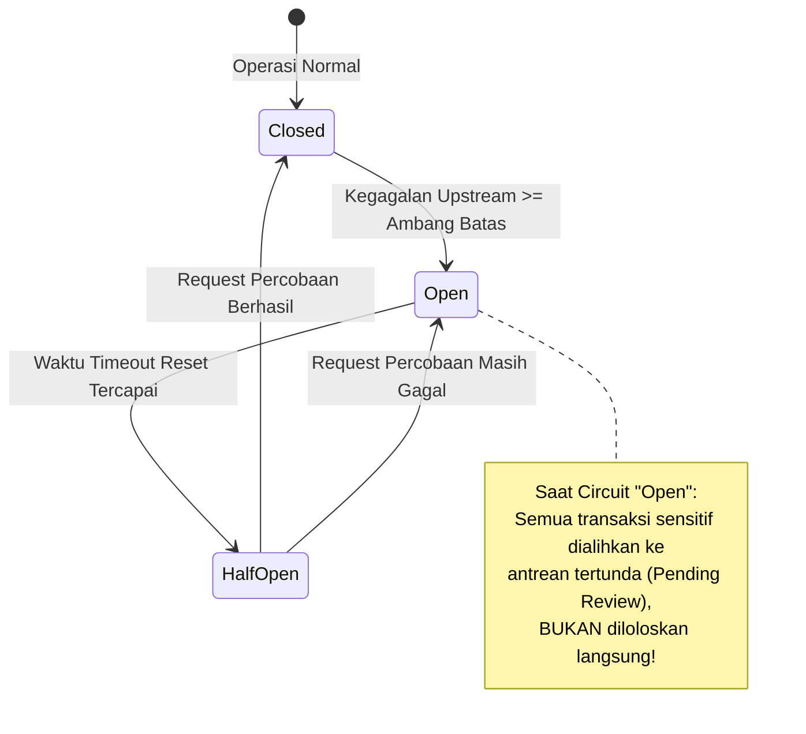

# Konsep Mendalam: Prinsip Fail-Safe Defaults dan Penanganan Eksepsi

Dalam makalah seminal tahun 1975 karya Jerome Saltzer dan Michael Schroeder (*The Protection of Information in Computer Systems*), dirumuskan prinsip desain keamanan paling penting: **Fail-Safe Defaults**. Prinsip ini menyatakan bahwa **kondisi default dari suatu sistem harus selalu berada pada keadaan paling aman dan menolak akses (*Deny by Default*)**.

---

## 1. Perbandingan Arsitektur: Fail-Closed vs Fail-Open

Memahami perbedaan antara Fail-Closed dan Fail-Open adalah esensi dari kategori **OWASP A10:2025 – Mishandling of Exceptional Conditions**.

| Karakteristik | Fail-Closed (Gagal-Terkunci) | Fail-Open (Gagal-Terbuka) |
| :--- | :--- | :--- |
| **Prilaku Saat Error / Timeout** | **TOLAK AKSES (Deny / Block)** | **IZINKAN AKSES (Allow / Pass)** |
| **Prioritas Sistem** | Integritas dan Keamanan Informasi | Ketersediaan (*Availability*) dan Kenyamanan Pengguna |
| **Konsekuensi Kegagalan** | Pengguna yang sah mungkin terganggu sementara (*Denial of Service* sementara). | **Penyerang mendapatkan akses tanpa izin (*Unauthorized Bypass*)**. |
| **Kasus Penggunaan yang Sah** | Gerbang pembayaran, autentikasi login, firewall jaringan, API perbankan. | Pintu darurat kebakaran gedung (*Fire Exit Doors* membuka saat alarm menyala). |

```
              ┌─────────────────────────────────────────┐
              │ Terjadi Eksepsi / Upstream Gate Timeout │
              └────────────────────┬────────────────────┘
                                   │
         ┌─────────────────────────┴─────────────────────────┐
         ▼                                                   ▼
[ Model FAIL-CLOSED ]                               [ Model FAIL-OPEN ]
   authorized = False                                  authorized = True
   HTTP 503 / 504 Gateway Error                        HTTP 200 OK (Bypass Terjadi!)
   🛡️ SISTEM TETAP AMAN                                ❌ SISTEM DIBOBOBOBO PENYERANG!
```

---

## 2. Taksonomi Anti-Pattern Penanganan Eksepsi

Dalam pengembangan aplikasi, ada 4 anti-pattern umum yang membuka kerentanan keamanan luar biasa:

### A. Generic Catch Block (*Catch-All Exception*)
Menangkap semua kelas error menggunakan kelas induk tertinggi (seperti `catch (Exception e)` di Java/C# atau `except Exception:` di Python). Tindakan ini mencampuradukkan error jaringan sementara dengan kesalahan fatal integritas data, pelanggaran skema, atau pembobolan memori.

### B. Exception Swallowing (*Menelan Eksepsi Tanpa Jejak*)
Menangkap eksepsi dan mengabaikannya tanpa mencatat ke dalam log audit keamanan:
```python
# ANTI-PATTERN: Exception Swallowing
try:
    verify_fraud_score(user)
except Exception:
    pass  # Tidak ada log, tidak ada alert, pemrosesan dilanjutkan!
```

### C. Default-Allow Fallback
Menginisialisasi variabel otorisasi dengan nilai `True` atau menetapkan nilai `True` di dalam blok `catch`:
```python
# ANTI-PATTERN: Default-Allow
authorized = True
try:
    if check_blacklist(ip):
        authorized = False
except Exception:
    pass  # Jika blacklist database timeout, authorized tetap True!
```

### D. Bocoran Stack Trace Internal (CWE-209)
Mengembalikan pesan error mentah dari database atau runtime ke klien HTTP:
```json
{
  "error": "OperationalError: (sqlite3.OperationalError) no such column: pass_hash [SQL: SELECT pass_hash FROM users...]"
}
```
Informasi ini membocorkan skema tabel dan teknologi backend kepada penyerang.

---

## 3. Menangani Kegagalan Upstream Secara Aman: Circuit Breaker

Ketika layanan bergantung pada verifikator pihak ketiga (seperti Payment Gateway atau Fraud Detection API) yang lambat atau tidak stabil, solusi yang benar **bukan meloloskan transaksi secara buta (Fail-Open)**, melainkan mengadopsi pola **Circuit Breaker** dengan antrean asinkron (*Safe Asynchronous Fallback*):



1. **State Closed**: Semua request diverifikasi secara normal ke layanan hulu.
2. **State Open**: Ketika layanan hulu mengalami timeout berulang, sirkuit memutus koneksi langsung untuk melindungi performa sistem. Request otorisasi ditandai sebagai `PENDING_REVIEW` dan dimasukkan ke antrean terisolasi, **bukan disetujui instan**.
3. **State Half-Open**: Mengirim sebagian kecil request uji coba untuk mengecek apakah layanan hulu telah pulih.
