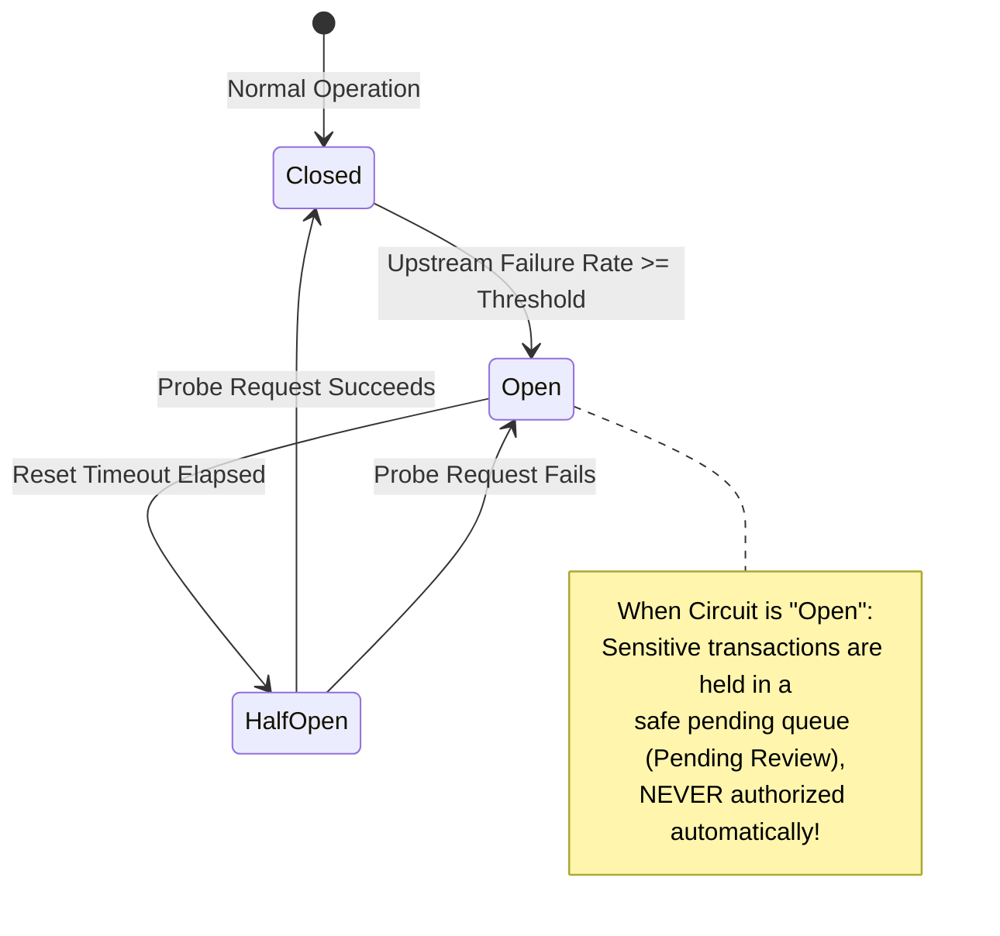

# Core Concepts: Fail-Safe Defaults & Defensive Exception Handling

In Jerome Saltzer and Michael Schroeder's seminal 1975 treatise (*The Protection of Information in Computer Systems*), they articulated one of the most vital axioms of computer security: **Fail-Safe Defaults**. This foundational principle dictates that **the baseline default state of any security mechanism must always be to deny access (*Deny by Default*)**.

---

## 1. Architectural Paradigms: Fail-Closed vs Fail-Open

Distinguishing between Fail-Closed and Fail-Open behaviors forms the core thesis of **OWASP A10:2025 – Mishandling of Exceptional Conditions**.

| Criterion | Fail-Closed (Secure Standard) | Fail-Open (Critical Vulnerability) |
| :--- | :--- | :--- |
| **Behavior on Error / Timeout** | **DENY / REJECT ACCESS** | **ALLOW / GRANT ACCESS** |
| **System Priority** | Information Security & Integrity | Transaction Availability & Frictionless UX |
| **Failure Consequence** | Legitimate users may face temporary service interruptions. | **Unauthorized adversaries bypass authorization completely**. |
| **Legitimate Real-World Use Case** | Financial payment gates, authentication, perimeter firewalls. | Commercial building fire exit doors unlocking automatically during power failure. |

```
              ┌─────────────────────────────────────────┐
              │ Exception Occurs / Upstream Timeout     │
              └────────────────────┬────────────────────┘
                                   │
         ┌─────────────────────────┴─────────────────────────┐
         ▼                                                   ▼
[ FAIL-CLOSED Model ]                               [ FAIL-OPEN Model ]
   authorized = False                                  authorized = True
   HTTP 503 / 504 Gateway Error                        HTTP 200 OK (Security Bypass!)
   🛡️ SYSTEM REMAINS SECURE                            ❌ CRITICAL SECURITY COMPROMISE
```

---

## 2. Taxonomy of Exception Handling Anti-Patterns

In production software engineering, four prevalent anti-patterns create severe security exposures:

### A. Generic Catch-All Blocks
Catching all exceptions using the root class (such as `except Exception:` in Python or `catch (Exception e)` in Java/C#). This dangerously conflates transient network timeouts with severe type mismatches, syntax errors, and schema corruption.

### B. Exception Swallowing
Interception of critical failure events without structured logging or alerting:
```python
# ANTI-PATTERN: Exception Swallowing
try:
    verify_fraud_score(user)
except Exception:
    pass  # No logs, no alarms; processing continues silently!
```

### C. Default-Allow Fallback
Initializing security authorization flags to `True` or defaulting to an affirmative state inside error handlers:
```python
# ANTI-PATTERN: Default-Allow
authorized = True
try:
    if check_ip_blacklist(client_ip):
        authorized = False
except Exception:
    pass  # If blacklist datastore times out, authorized remains True!
```

### D. Internal Information Disclosure (CWE-209)
Emitting unhandled exception traces containing database connection strings, local filesystem paths, or library versions directly to HTTP response bodies.

---

## 3. Resilient Upstream Handling: The Circuit Breaker Pattern

When an application depends upon external upstream verification services (e.g., credit card fraud detectors, KYC services) that suffer latency spikes, the correct remedy is **NEVER to bypass verification (Fail-Open)**. Instead, architects implement the **Circuit Breaker Pattern** with asynchronous deferred queuing:



1. **Closed State**: All verification queries route normally to the upstream provider.
2. **Open State**: When consecutive failures cross safe thresholds, the breaker trips to prevent system exhaustion. Requests are routed to a **quarantined asynchronous holding queue** (`PENDING_REVIEW`) rather than granting instant unearned clearance.
3. **Half-Open State**: A fraction of traffic probes upstream liveness to determine whether normal verification can safely resume.
